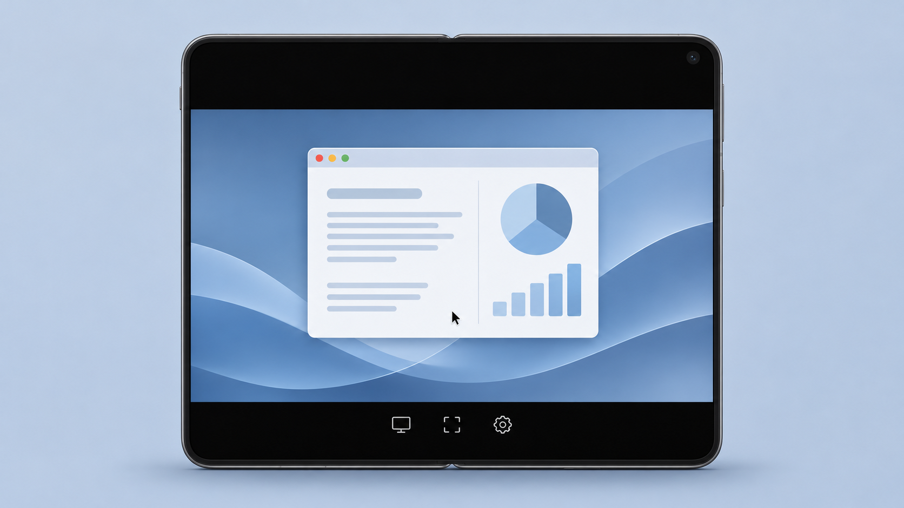

# OPPO 远控分辨率助手

OPPO 远控分辨率助手是一个 macOS 分辨率助手，适用于使用 O+ Connect（OPPO 互联）远控 Mac 的场景。


<p align="center">macOS 实际界面 · 悬浮按钮跟随 O+ Connect 窗口</p>



<p align="center">外观参考 OPPO Find N6 / N5 · 远控画面为虚构示意</p>

## 下载与使用

1. 从 [GitHub Releases](https://github.com/firzen/oppo-remote-scale/releases/latest) 下载通用版 ZIP。
2. 解压并打开 `OPPO 远控分辨率助手.app`。应用支持 macOS 15 及更新版本，包含 Intel 和 Apple 芯片架构。
3. 在 O+ Connect 中开始远控。连接稳定后，OPPO 远控分辨率助手会将主屏切到手机友好分辨率。在已测试的 Mac 上，该档位为 1280 × 800。断开后自动恢复切换前的模式。
4. 可通过 macOS 菜单栏的显示器图标手动选择「手机友好」或「恢复」。O+ Connect 窗口可见时，窗口旁也会显示相同按钮。

屏幕尺寸以 macOS 的实际回读结果为准。O+ Connect 当前会话的视频流可能继续使用连接建立时的采集尺寸。

发布包使用临时签名，尚未经过 Apple 公证。下载后的应用可能会被 Gatekeeper 拦截。

## 本地构建

需要 Xcode Command Line Tools。

```sh
./build.sh
```

构建结果位于 `build/OPPO 远控分辨率助手.app`。

## 工作方式

OPPO 远控分辨率助手在本机读取 O+ Connect 的远控会话日志，通过 Core Graphics 调整主屏分辨率。运行时无需第三方依赖。自动切换依赖 O+ Connect 的日志格式，客户端更新后可能需要适配。

OPPO 远控分辨率助手是独立工具，与 OPPO 无隶属关系。
