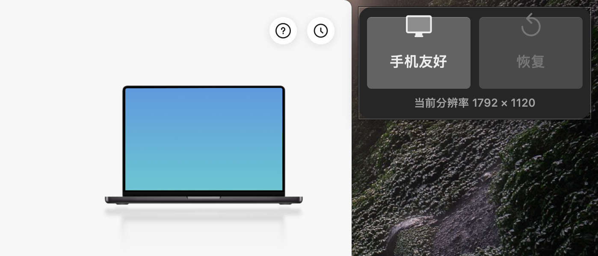
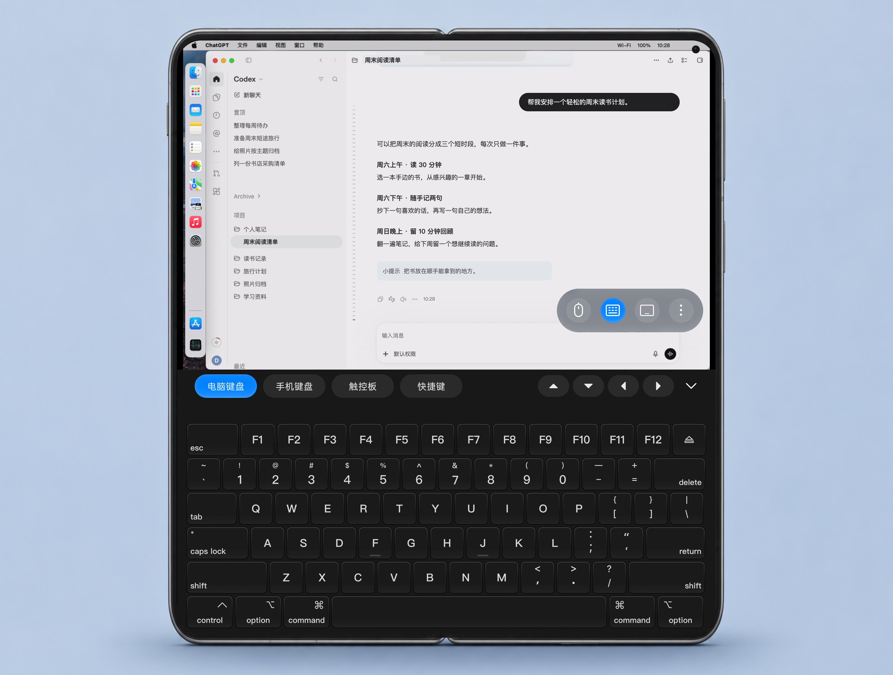
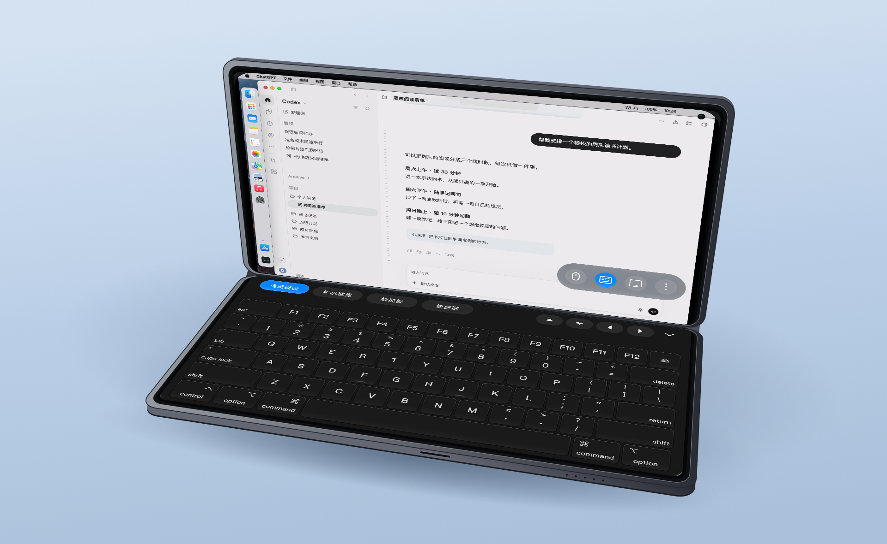

# OPPO 远控分辨率助手

OPPO 远控分辨率助手是一个 macOS 分辨率助手，适用于使用 O+ Connect（OPPO 互联）远控 Mac 的场景。



<p align="center">macOS 实际界面 · 悬浮按钮跟随 O+ Connect 窗口</p>



<p align="center">外框参考 OPPO Find N6 / N5 · 屏幕内为脱敏后的实际远控截图</p>



<p align="center">90° 半折效果示意 · 上半屏显示 Mac 桌面，下半屏显示远控键盘</p>

## 下载与使用

1. 从 [GitHub Releases](https://github.com/firzen/oppo-remote-scale/releases/latest) 下载通用版 ZIP。
2. 解压并打开 `OPPO 远控分辨率助手.app`。应用支持 macOS 15 及更新版本，包含 Intel 和 Apple 芯片架构。
3. 在 O+ Connect 中开始远控。Mac 锁屏时保持原分辨率，确认解锁并进入桌面后才切换。在已测试的 Mac 上，手机友好分辨率为 1152 × 720。检测到断开后等待 3 秒。期间重新连入会保留当前档位，否则自动恢复记录的原分辨率。没有原分辨率记录且内屏仍处于手机友好档位时，恢复到系统默认分辨率。
4. 可通过 macOS 菜单栏的显示器图标手动选择「手机友好」或「恢复」。O+ Connect 位于前台且窗口可见时，窗口旁也会显示相同按钮；切换到其他应用后按钮隐藏。

自动切换时，桌面上方会显示进度提示，完成后短暂显示系统读回的分辨率。

屏幕尺寸以 macOS 的实际回读结果为准。O+ Connect 当前会话的视频流可能继续使用连接建立时的采集尺寸。

发布包使用临时签名，尚未经过 Apple 公证。下载后的应用可能会被 Gatekeeper 拦截。

## 本地构建

需要 Xcode Command Line Tools。

```sh
./build.sh
```

构建结果位于 `build/OPPO 远控分辨率助手.app`。

## 远控自检

用手机连接一次，切换分辨率，再断开并重新连接。从仓库目录运行以下命令，查看最近两天的连接日志、抓屏启停和 O+ Connect 记录的输出尺寸。

```sh
"build/OPPO 远控分辨率助手.app/Contents/MacOS/RemoteScale" --remote-check
log show --last 1h --style compact --predicate 'process == "RemoteScale" AND eventMessage BEGINSWITH "RemoteScale "'
```

按时间对照助手日志中的 `switch-readback` 与抓屏日志中的 `UpdateCaptureParam`。抓屏日志显示 Mac 端记录的输出参数，手机上的实际画面以实机观察为准。

## 工作方式

OPPO 远控分辨率助手在本机读取 O+ Connect 的远控会话日志，通过 Core Graphics 调整主屏分辨率。切换前按显示器 UUID 保存原档位和目标档位。助手异常退出后，重新打开时会检查恢复记录。远控已断开且显示器仍处于目标档位时自动恢复，发现显示模式已另行改变时可手动恢复。运行时无需第三方依赖。自动切换依赖 O+ Connect 的日志格式，客户端更新后可能需要适配。

OPPO 远控分辨率助手是独立工具，与 OPPO 无隶属关系。

## 钉钉待办

点击「授权钉钉」完成授权后，可用「立即同步」读取跨组织、本人执行的未完成待办。「待办列表」列出最近读取的全部待办，多行标题预览第一行，长标题单行显示，悬停可查看全文。主菜单可直接控制菜单栏轮播（默认关闭，仅显示图标；开启后每 6 秒切换标题）、备忘录写入和每半小时自动同步。自动同步默认关闭，已授权时开启即同步。重启后按上次成功时间安排，已到期则立即补同步。菜单显示上次成功和下次同步时间。同步失败后半小时重试，也可手动重试。备忘录写入失败时仍可查看本次读取的列表，权限被拒绝时可从菜单打开自动化设置。

开启备忘录同步时，每个任务对应默认账号「钉钉待办同步」文件夹中的一篇笔记，以任务 ID 区分同名任务。沿用 DingTodoBar 的同步标记，只清理带标记且不再出现在完整未完成列表中的笔记，保留未标记笔记。读取成功与备忘录写入成功分别显示状态。取消写入可能留下部分更新，再次同步可重新核对。

备忘录写入由应用内的辅助进程执行，避免等待 Notes 响应时阻塞远控检测。不主动激活备忘录窗口，但 Notes 可能在 Dock 显示运行图标。首次写入需要允许本应用控制备忘录。

首次启动会尝试从 DingTodoBar 的本机凭证文件迁移授权，原文件保留。迁移后的凭证保存在 `~/Library/Application Support/OPPORemoteOptimize/credentials.json`，目录权限为 `0700`，文件权限为 `0600`，不使用钥匙串。迁移后使用本应用同步，避免同时运行旧应用造成刷新令牌竞争。无需 PHP 或钉钉 CLI。

项目采用 Objective-C 与 Swift 混合构建：`main.m` 负责远控和分辨率，`Sources/Todo/` 负责授权、MCP 请求、菜单桥接和备忘录同步。构建需要包含 Swift 编译器的 Xcode Command Line Tools。待办协议模块复用自本机 DingTodoBar 项目，保留分页、重复页检测、令牌刷新和 SSE 解析处理。

```sh
./Tests/run.sh
"build/OPPO 远控分辨率助手.app/Contents/MacOS/TodoNotesHelper" --read-check
```

第二条命令使用迁移后的授权验证真实待办读取，只输出数量和页数，不写入备忘录。模拟测试覆盖授权、令牌刷新、MCP 请求、分页与本机凭证存储；真实跨组织完整覆盖范围仍取决于钉钉账号权限和服务响应。
